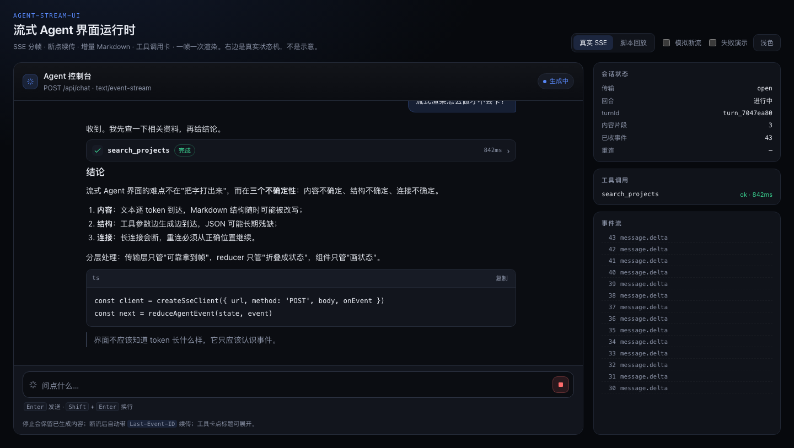
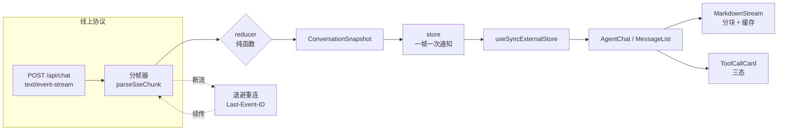

# agent-stream-ui

**Agent 流式事件 → React 界面的最小运行时。**
SSE 分帧 · 断点续传 · 增量 Markdown · Tool Call 卡片 · 停止/重试 · 一帧一次渲染。

> Agent 产品的前端难点不是"把字打出来"，而是把三个不确定性变成用户能看懂、能干预、能恢复的界面。



---

## 为什么需要它

把模型接进界面的第一版通常长这样：`fetch` 拿到流、`setState(全文)`、`dangerouslySetInnerHTML` 一下。上线后依次遇到：

1. **内容不确定**：每来一个 token 就全量 parse Markdown，长回答直接掉帧；
2. **结构不确定**：工具参数边生成边到达，`JSON.parse` 一直是异常；
3. **连接不确定**：网络闪断、网关静默超时，界面永远停在"生成中"，用户只能刷新。

这个库把三件事拆开：**传输层只负责可靠地拿到帧，reducer 只负责把帧折叠成状态，组件只负责画状态**。任何一层都能单独替换、单独测试。

| 层 | 只做一件事 | 可替换为 |
| --- | --- | --- |
| `sse/` | POST + `text/event-stream`、分帧、退避重连、游标续传、空闲看门狗 | WebSocket / gRPC / IPC |
| `core/` | 事件 → 会话状态（纯函数）、一帧一次通知 | 任意 UI 框架 |
| `markdown/` | 分块解析 + 已闭合块缓存 | 流式编辑器 / 虚拟列表 |

---

## 快速开始

```bash
npm install
npm run dev        # 同时起 mock agent（8787）和 vite（5173）
```

打开 <http://localhost:5173>。右边是真实的 store 快照与事件流，不是示意图。

- **模拟断流**：mock 服务在第 3 帧后直接掐断 TCP。前端靠空闲看门狗发现、带 `Last-Event-ID` 重连、从第 4 帧继续，**事件总数与无断流时完全一致（58 条，无重复）**。
- **失败演示**：工具返回 502 → 错误态 → 重试入口。
- **脚本回放**：`?mock` 不用后端也能跑（生产构建默认走这条，方便静态托管）。

只跑前端：`npm run dev:web`（需要 mock 服务在 8787）。

### 作为库使用

```tsx
import { AgentChat, createAgentStream, createHttpTransport } from 'agent-stream-ui'
import 'agent-stream-ui/styles.css'

const store = createAgentStream({
  transport: createHttpTransport({ url: '/api/chat' }),
  // 生产建议打开：超过 20s 没有帧就判定连接已死
  idleTimeoutMs: 20_000,
})

export default () => <AgentChat store={store} title="Agent 控制台" />
```

只需要逻辑、不要 UI 时：

```ts
import { createAgentStream, splitBlocks, parseSseChunk, reduceAgentEvent } from 'agent-stream-ui'
```

---

## 架构



### 事件协议

| event | payload | 说明 |
| --- | --- | --- |
| `turn.start` | `{ turnId }` | 一回合开始（可重复，后者覆盖） |
| `message.delta` | `{ text }` | 文本增量，按到达顺序拼接 |
| `tool.call` | `{ callId, name, arguments? }` | 工具调用开始；`arguments` 可能是半截 JSON |
| `tool.result` | `{ callId, ok, preview?, durationMs? }` | 工具结束；`durationMs` 缺省时前端用本地时钟补 |
| `message.done` | `{ messageId? }` | 正文完成（预留：服务端落库确认） |
| `turn.end` | `{ reason: 'complete' \| 'stopped' \| 'error' }` | 回合结束；`stopped` 表示用户主动停 |
| `error` | `{ message, stage?, retriable? }` | 失败；`stage` 用于区分检索/分析/生成 |
| `ping` | `{}` | 心跳，reducer 返回同一快照（不触发渲染） |

`id` 是服务端出站游标（单调递增），用于断点续传与去重。

---

## 几个关键取舍

完整版见 [docs/design-notes.md](docs/design-notes.md)，这里只列结论：

| 决策 | 选择 | 代价 |
| --- | --- | --- |
| 传输 | 手写 `fetch` + SSE，不用 `EventSource` | 多 200 行；换来 POST、自定义 header、可控退避 |
| 重连判定 | 只对 5xx / 408 / 429 / 网络错误重试 | 4xx 直接失败，避免空转 |
| 流的 EOF | 当作"没收到 `turn.end` 的断流" | 需要 `turn.end` 后主动 `close()` |
| 半开连接 | 空闲看门狗（可选，默认关） | 首帧很慢的业务需要把阈值放大 |
| Markdown | 分块 + 已闭合块缓存，不碰 `innerHTML` | 不支持表格与内联 HTML |
| 通知频率 | 状态立即更新，通知按帧合并 | 极短生命周期的事件会被合并（对 UI 无影响） |
| 工具参数 | 只做括号/逗号级修复，不做语义猜测 | 截断在字符串中间时只显示原文 |

---

## 测试

```bash
npm test        # 77 个用例
npm run typecheck
npm run build   # demo
npm run build:lib
```

覆盖：分帧边界（CRLF、多行 data、半帧拼接）、重连与去重、空闲看门狗、4xx/5xx 分流、reducer 全部状态迁移、Markdown 分块与 XSS、工具卡三态、停止/重试交互。

---

## 已知边界

- Markdown 只支持对话够用的子集：标题、段落、围栏代码、列表（不嵌套）、引用、分割线。**不支持表格与内联 HTML**（安全与成本考虑，见 design-notes）。
- 不做消息虚拟化：单轮几万字以内够用，更长需要上层套虚拟列表。
- 未做多端适配（窄屏会退化为单栏）。
- 没有内置鉴权：`headers` 自行注入，token 刷新建议放在传输层之外。

## License

MIT
